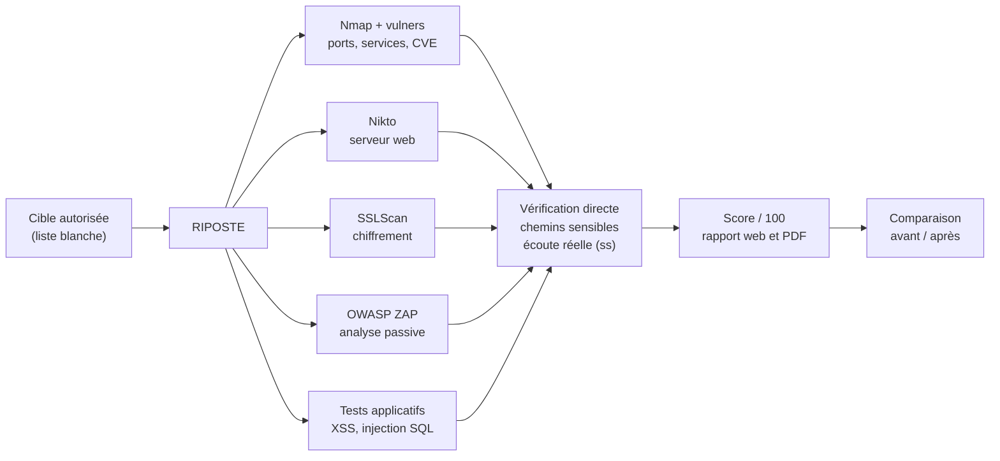
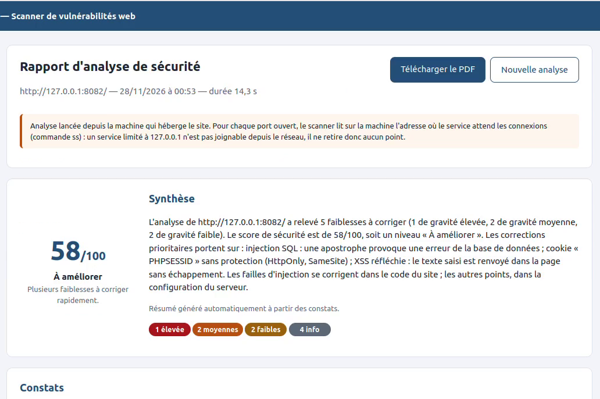
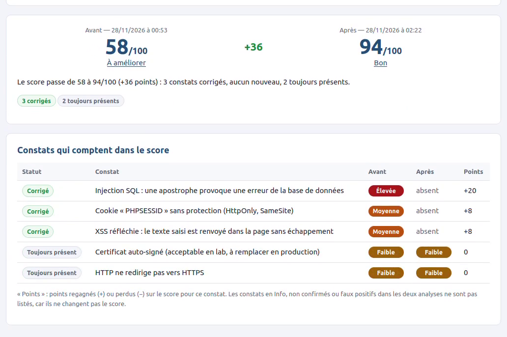

# RIPOSTE

### Plateforme d'audit de sécurité web, de la détection à la correction

**Détecter. Exploiter. Corriger. Prouver.**

RIPOSTE est un outil que j'ai développé en Python. Il analyse la sécurité d'un site web autorisé avec plusieurs outils de référence, vérifie lui-même chaque alerte pour écarter les faux positifs, teste les failles d'injection les plus courantes, puis donne un score sur 100 et un rapport en français, avec une correction pour chaque faille. Il compare aussi deux analyses pour prouver qu'une correction a fonctionné.

L'outil a été construit et éprouvé au fil de **huit études**, menées sur quatre cibles de mon laboratoire. Projet pédagogique : tout tourne en local, dans une machine virtuelle Ubuntu, et aucune analyse n'a visé un site réel.

[L'outil](#loutil) · [Les études](#les-études) · [Le laboratoire](#le-laboratoire) · [Qualité](#qualité) · [Démarrage rapide](#démarrage-rapide) · [Cadre éthique](#cadre-éthique)

**Rapport de projet complet (PDF, 22 pages)** : [lire sur GitHub](docs/rapport-projet.pdf) ou [télécharger](https://github.com/Youcef9897/riposte-scanner-vulnerabilites/raw/main/docs/rapport-projet.pdf).

---

## En bref

| Résultat | Ce que ça mesure |
|---|---|
| **8 études** | Menées sur 4 cibles locales : un serveur Apache, NetStock Lab, DVWA, OWASP Juice Shop |
| **58 → 94 / 100** | NetStock Lab : failles d'injection détectées par l'outil, puis corrigées (étude 7) |
| **51 → 97 / 100** | Serveur web Apache, avant et après durcissement (étude 1) |
| **8 / 8** | Failles de la boutique corrigées, chacune prouvée par un test (étude 6) |
| **102 tests** | Tests automatiques au vert |
| **15 à 40 s** | Par analyse, contre 5 à 7 min pour la première version |

---

## L'outil

### Ce qu'il fait

| Fonction | Détail |
|---|---|
| **Analyse multi-outils** | Nmap (ports, versions, CVE connues avec le script vulners), Nikto, SSLScan et, en option, OWASP ZAP en mode passif, lancés en parallèle, chacun avec une durée maximale. |
| **Vérification de chaque constat** | Chaque alerte est rejouée par une requête directe au site, puis classée *Confirmé*, *À vérifier*, *Non confirmé* ou *Faux positif probable*. Seuls les constats confirmés ou à vérifier comptent dans le score. |
| **Tests applicatifs de base** | XSS réfléchie (marqueur texte inoffensif) et injection SQL révélée par une erreur (une apostrophe, puis une contre-épreuve avec deux), dans les formulaires de recherche et de connexion uniquement. |
| **Contrôles complémentaires** | 47 chemins sensibles (sauvegardes, fichiers de configuration, listage de dossiers), en-têtes de sécurité, cookies, certificat TLS (auto-signé, expiré, mauvais nom), HSTS, redirection HTTP vers HTTPS. |
| **Lecture du contexte réel** | Sur la machine hôte, l'adresse d'écoute de chaque port est lue avec `ss` : un service joignable uniquement en local est signalé pour information, sans pénaliser le score. |
| **Score expliqué** | Barème affiché dans chaque rapport, et un paragraphe « Périmètre » qui dit ce que l'analyse ne teste pas. |
| **Comparaison avant / après** | Écart de score et statut de chaque constat : *Corrigé*, *Atténué*, *Plus vérifiable*, *Nouveau*, *Aggravé*, *Inchangé*. |
| **Rapports** | Page web et PDF en français : synthèse, constats, preuves, recommandations, références OWASP Top 10:2025 et CWE. Le PDF a un sommaire dépliable et des liens du tableau vers le détail de chaque constat. |
| **Résumé en langage clair** | Rédigé par un modèle de langage qui tourne en local (Mistral via Ollama) : aucune donnée ne quitte la machine. Sans Ollama, RIPOSTE rédige lui-même le résumé à partir des constats. |
| **Garde-fous** | Liste blanche de cibles (`localhost`, `127.0.0.1`, `192.168.56.0/24` par défaut) et confirmation d'autorisation obligatoire avant toute analyse. |

### Comment se déroule une analyse



1. **Contrôle de la cible** : l'adresse doit être dans la liste blanche, et l'utilisateur doit confirmer qu'il est autorisé à l'analyser.
2. **Collecte** : les outils sont lancés en parallèle ; les tests applicatifs explorent au plus 12 pages et envoient au plus 80 requêtes.
3. **Vérification** : chaque alerte est rejouée, les chemins sensibles sont demandés, l'adresse d'écoute de chaque port est lue.
4. **Rédaction** : chaque constat reçoit une gravité, une preuve, une recommandation et une référence (OWASP, CWE, CVE).
5. **Score et rapport** : barème appliqué aux constats retenus, rapport web et PDF, puis comparaison avec une analyse précédente.

### Comment il est construit

| Domaine | Technologies |
|---|---|
| Plateforme | Python 3, Flask, Jinja, requests |
| Rapport PDF | ReportLab (signets, liens internes) |
| Outils d'analyse | Nmap et le script vulners, Nikto, SSLScan, OWASP ZAP 2.17 piloté par son API |
| Système | Ubuntu 22.04 (VirtualBox), Apache 2.4, `ss`, Docker pour DVWA et Juice Shop |
| IA locale | Ollama et le modèle Mistral, en option, pour le résumé |
| Tests | pytest : 102 tests, dont des tests face à un vrai serveur HTTPS et à la boutique lancée dans un serveur PHP jetable |

<details>
<summary><strong>Organisation du code</strong></summary>

| Module | Rôle |
|---|---|
| `app.py` | Application Flask : formulaire, suivi de l'analyse, pages de rapport et de comparaison |
| `cible.py`, `config.py` | Contrôle de la cible (liste blanche) et réglages |
| `scan.py`, `outils.py` | Lancement des outils en parallèle et lecture de leurs sorties |
| `analyse.py`, `constats.py` | Transformation des sorties en constats rédigés en français |
| `verification.py`, `chemins.py`, `ecoute.py` | Vérification directe, chemins sensibles, adresse d'écoute des ports |
| `applicatif.py` | Tests applicatifs : XSS réfléchie et injection SQL révélée par une erreur |
| `zap.py`, `regles_zap.py` | Pilotage de ZAP et fiches françaises de ses alertes |
| `score.py`, `resume.py`, `texte.py` | Score, niveau, périmètre, résumé et rédaction (accords, durées) |
| `comparaison.py`, `rapport_pdf.py` | Comparaison de deux analyses et génération des PDF |

</details>

<details>
<summary><strong>Barème du score</strong></summary>

| Gravité | Points retirés | Niveau | Score |
|---|---|---|---|
| Élevée | −20 | Bon | 90 à 100 |
| Moyenne | −8 | Correct | 75 à 89 |
| Faible | −3 | À améliorer | 50 à 74 |
| Info | 0 | Insuffisant | moins de 50 |

Le score part de 100. Les constats non confirmés et les faux positifs probables ne sont pas comptés : un outil qui se trompe ne doit pas faire baisser la note.

</details>

---

## Les études

Une seule plateforme, éprouvée par huit études. Chacune part d'une question, mesure, corrige la cible ou améliore l'outil, puis prouve le résultat. Cliquer sur une étude pour la déplier.

| # | Question | Cible | Résultat |
|---|---|---|---|
| 1 | Que regagne-t-on en durcissant un serveur web ? | Serveur Apache | 51 → 97 / 100 |
| 2 | Un bon score veut-il dire un site sûr ? | NetStock Lab | 86 / 100, verdict réel : critique |
| 3 | Que trouve-t-on à la main, là où les outils ne voient rien ? | NetStock Lab | 4 failles exploitées |
| 4 | La méthode tient-elle sur des cibles connues ? | DVWA, Juice Shop | Injections réussies, défi officiel validé |
| 5 | Qu'apporte OWASP ZAP ? | NetStock Lab | 2 constats de plus, 80 → 91 / 100 après correction |
| 6 | Peut-on corriger et le prouver ? | NetStock Lab | 8 / 8 failles corrigées, 11 tests inversés |
| 7 | L'outil peut-il trouver seul les injections ? | NetStock Lab | 58 → 94 / 100 |
| 8 | Comment écarter les fausses alertes ? | Toutes | 5 cas de faux positifs traités |

<details>
<summary><strong>Étude 1 — Durcir un serveur web Apache : 51 → 97 / 100</strong></summary>

**Question.** Que vaut un serveur Apache tel qu'installé, et combien de points regagne-t-on en le durcissant ?

**Avant (16 novembre) : 51 / 100, « À améliorer ».** 8 faiblesses à corriger, dont 5 moyennes :

| Constat de départ | Gravité |
|---|---|
| Code source ou copie de sauvegarde téléchargeable | Moyenne |
| Listage du contenu d'un dossier | Moyenne |
| Pas de protection contre le « clickjacking » | Moyenne |
| Site disponible uniquement en HTTP | Moyenne |
| 85 CVE connues pour la version d'Apache installée | Moyenne |
| En-tête X-Content-Type-Options absent, pas de CSP, version du serveur affichée | Faible |

**Corrections.**
- En-têtes de sécurité : X-Frame-Options, X-Content-Type-Options, Referrer-Policy, Permissions-Policy, Content-Security-Policy.
- Version du serveur masquée (`ServerTokens Prod`, `ServerSignature Off`), méthode TRACE coupée.
- Listage des dossiers désactivé (`Options -Indexes`), ancienne version de l'outil déplacée hors du site.
- Mise à jour d'Apache.
- HTTPS : certificat RSA 3072 bits, TLS 1.2 et 1.3 uniquement, HSTS, redirection de HTTP vers HTTPS.

**Résultat.** 92 / 100 après les en-têtes et le listage, puis **97 / 100 — « Bon »** après la mise à jour et le passage en HTTPS. La comparaison générée par RIPOSTE donne **+46 points** : 7 constats corrigés, 1 devenu « plus vérifiable » (les CVE d'Apache, après la mise à jour), 1 nouveau constat attendu (le certificat auto-signé, normal en laboratoire).

</details>

<details>
<summary><strong>Étude 2 — Un bon score sur un site plein de failles : 86 / 100, verdict critique</strong></summary>

**Question.** Le score reflète-t-il la sécurité réelle d'un site ?

NetStock Lab, la boutique volontairement vulnérable du laboratoire, obtenait **86 / 100 — « Correct »** avec les premières versions de l'outil. L'analyse relevait le cookie de session sans protection, le certificat auto-signé et l'absence de redirection HTTPS, mais aucune des 8 failles applicatives de la boutique. Pourtant, à la main, on se connecte au compte d'un client sans son mot de passe et on lit les commandes des autres clients.

**Conclusion : un score de configuration n'est pas un niveau de sécurité.** Nmap, Nikto, SSLScan et ZAP en mode passif notent le serveur ; ils ne peuvent pas savoir qu'une requête SQL est construite avec les données du visiteur.

**Ce qui a changé dans l'outil.** Chaque rapport contient désormais un paragraphe « Périmètre » qui dit ce que l'analyse ne teste pas, et les failles trouvées à la main sont présentées à part, avec leur vraie gravité. Cette étude a aussi mené à l'étude 7.

</details>

<details>
<summary><strong>Étude 3 — Exploiter les failles à la main : 4 failles de NetStock Lab</strong></summary>

**Question.** Que trouve-t-on à la main, là où les outils automatiques ne voient rien ?

Tests faits dans Firefox et ses outils de développement, uniquement sur la boutique locale.

| Faille | Démonstration |
|---|---|
| Injection SQL (connexion) | La requête colle l'adresse saisie : `WHERE email = '$email' AND mot_de_passe = MD5('$mdp')`. Avec `alice@netstock.lab' -- -`, la vérification du mot de passe devient un commentaire : connexion au compte d'Alice sans son mot de passe. |
| Accès aux commandes d'un autre client (IDOR) | `commande.php?id=1` charge la commande sans vérifier à qui elle appartient : Alice lit le nom, l'adresse et les achats de Bob. |
| XSS réfléchi (recherche) | Le mot recherché est réaffiché sans échappement : un script placé dans l'adresse s'exécute dans le navigateur. |
| Prix envoyé par le navigateur | Le prix est dans un champ caché que le serveur croit : un point d'accès à 89,90 € passe dans le panier à 0,01 €. |

**Conclusion.** Les outils automatiques sont indispensables pour la configuration ; les tests manuels le sont pour la logique de l'application.

</details>

<details>
<summary><strong>Étude 4 — Valider la méthode sur des cibles de référence : DVWA et OWASP Juice Shop</strong></summary>

**Question.** La méthode tient-elle sur des cibles connues de la communauté ?

Les deux cibles tournent dans Docker et ne sont publiées que sur `127.0.0.1` (vérifié avec `ss -tlnp`).

- **DVWA (niveau Low)** : injection SQL `1' OR '1'='1` qui expose les 5 comptes de la base, et XSS réfléchi.
- **OWASP Juice Shop** : connexion au compte administrateur par injection SQL ; le défi officiel « Login Admin » est validé par l'application.

Aucune de ces failles n'est détectée par Nmap, Nikto, SSLScan ou ZAP en mode passif, ce qui confirme la conclusion de l'étude 2.

</details>

<details>
<summary><strong>Étude 5 — Ajouter OWASP ZAP : 2 constats de plus, 80 → 91 / 100 après correction</strong></summary>

**Question.** Qu'apporte un scanner applicatif comme OWASP ZAP, utilisé en mode passif ?

RIPOSTE pilote ZAP 2.17.0 par son API : ZAP explore le site, observe les réponses sans lancer d'attaque, et ses alertes sont traduites en fiches françaises, comme les autres constats.

- Sur NetStock Lab vulnérable, l'analyse avec ZAP donne **80 / 100 en 51 secondes**, contre 86 sans ZAP : ZAP voit davantage. Il ajoute une politique CSP trop permissive et un formulaire sans jeton anti-CSRF, et confirme le cookie de session sans protection.
- Après les corrections de l'étude 6, l'analyse avec ZAP passe à **91 / 100 — « Bon »** : le formulaire sans jeton anti-CSRF disparaît, et le cookie n'est plus signalé.

**Choix de méthode.** Les analyses avec et sans ZAP sont comparées séparément : elles n'utilisent pas les mêmes outils, et les mélanger fausserait la comparaison.

</details>

<details>
<summary><strong>Étude 6 — Corriger la boutique et le prouver : 8 / 8 failles corrigées</strong></summary>

**Question.** Peut-on corriger toutes les failles, et prouver qu'elles ne reviendront pas ?

| Faille | Correction |
|---|---|
| Injection SQL | Requête préparée, mot de passe vérifié avec `password_verify`, nouvel identifiant de session à la connexion |
| Accès aux commandes d'un autre client | La commande n'est chargée que si elle appartient au client connecté |
| Prix envoyé par le navigateur | Le prix est relu dans la base ; la valeur envoyée est ignorée |
| XSS réfléchi | Échappement de tout affichage avec `htmlspecialchars` |
| Mots de passe en MD5 sans sel | Hachage bcrypt avec sel |
| Erreur SQL affichée | Message générique pour le visiteur |
| Quantité négative | Quantité minimale de 1 |
| Code promo réutilisable | Un seul usage par panier |
| En plus | Jetons anti-CSRF sur tous les formulaires, en-têtes de sécurité, cookie de session HttpOnly et SameSite |

Exemple, pour la commande d'un client :

```php
// Avant : n'importe quel numéro de commande est accepté
... WHERE c.id = ?
// Après : la commande doit appartenir au client connecté
... WHERE c.id = ? AND c.client_id = ?
```

**Preuve.** Les attaques rejouées échouent : la même injection donne « Adresse e-mail ou mot de passe incorrect », le script de la recherche s'affiche comme du texte, et le panier garde le prix de 89,90 €. Les **11 tests de la boutique**, qui démontraient d'abord chaque faille, ont été inversés : ils vérifient maintenant que chaque attaque échoue. Si une faille revenait, un test passerait au rouge.

Les deux versions de la boutique restent dans le dépôt : la version vulnérable sur la branche `v3-s3-boutique`, la version corrigée sur `main`.

</details>

<details>
<summary><strong>Étude 7 — Faire détecter les injections par l'outil lui-même : 58 → 94 / 100</strong></summary>

**Question.** L'outil peut-il trouver seul les deux failles d'injection les plus courantes, sans rien casser sur le site ?

**Méthode.**
- **XSS réfléchie** : un marqueur texte inoffensif est envoyé dans chaque paramètre ; s'il revient dans la page sans échappement, la faille est confirmée.
- **Injection SQL révélée par une erreur** : une apostrophe est envoyée ; si la page affiche une erreur de la base de données, une contre-épreuve envoie deux apostrophes, qui ne doivent plus provoquer d'erreur.
- **Prudence** : seuls les formulaires de recherche et de connexion sont envoyés, jamais le panier ou une commande ; les liens de déconnexion ou de suppression ne sont pas suivis ; le jeton anti-CSRF est relu avant chaque envoi ; au plus 12 pages et 80 requêtes.

**Résultat.** Sur la boutique vulnérable, RIPOSTE trouve seul l'injection SQL de la connexion et la XSS de la recherche. Le score devient honnête : **86 → 58 / 100** (−20 pour l'injection SQL, −8 pour la XSS).



Après les corrections de l'étude 6, la nouvelle analyse donne **94 / 100 — « Bon »**. La comparaison indique **3 constats corrigés** (injection SQL +20, cookie de session +8, XSS +8), **aucun nouveau**, et **2 toujours présents** : le certificat auto-signé et l'absence de redirection vers HTTPS, normaux en laboratoire.



**Limite assumée.** Les failles de logique (prix, accès aux commandes d'un autre client) ne changent pas le score : elles restent testées à la main (étude 3).

</details>

<details>
<summary><strong>Étude 8 — Écarter les faux positifs : 5 cas traités</strong></summary>

**Question.** Comment éviter qu'un outil qui se trompe fasse baisser la note ?

| Fausse alerte | Ce que fait RIPOSTE |
|---|---|
| Méthode DEBUG signalée par Nikto : PHP répond 200 à toutes les méthodes, ce qui ressemblait à une faille (score de la boutique à 78 au lieu de 86) | Une vraie requête DEBUG est envoyée ; le constat n'est confirmé que si le serveur renvoie une réponse de débogage. Sinon : faux positif probable. |
| Fuite d'inode annoncée par Nikto dès qu'il voit un ETag | Les champs de l'ETag sont comptés : avec seulement la taille et la date du fichier, il n'y a pas d'inode, et l'alerte est écartée. |
| Cookie « sans HttpOnly » selon Nikto, alors qu'il est protégé | La vérification directe relit le cookie reçu : s'il porte HttpOnly, l'alerte est classée faux positif. |
| Base de données (port 3306) et service d'impression (port 631) ouverts | L'adresse d'écoute est lue avec `ss` : un service limité à `127.0.0.1` n'est pas joignable depuis le réseau, il est signalé pour information sans retirer de points. |
| CVE d'Apache qui disparaissent quand la version est masquée | Dans la comparaison, le constat passe en « Plus vérifiable », et non en « Corrigé » : masquer une version ne corrige pas une faille. |

Chaque cas est couvert par un test automatique.

</details>

---

## Le laboratoire

Tout le projet tourne dans une machine virtuelle Ubuntu 22.04 sous VirtualBox. Chaque cible de test n'écoute que sur l'adresse locale `127.0.0.1`.

| Cible | Rôle |
|---|---|
| Serveur Apache de la VM | Site vitrine, cible de l'étude 1 |
| **NetStock Lab** (`127.0.0.1:8082`) | Boutique de matériel réseau fictif que j'ai écrite en PHP avec MariaDB, volontairement vulnérable, avec deux comptes de test (Alice et Bob) |
| DVWA (`127.0.0.1:8081`) | Cible de référence, dans Docker |
| OWASP Juice Shop (`127.0.0.1:3000`) | Cible de référence, dans Docker |

<details>
<summary><strong>Les 8 failles de NetStock Lab</strong></summary>

| Faille | Ce qu'elle permet | Gravité réelle |
|---|---|---|
| Injection SQL (connexion) | Se connecter au compte d'un client sans son mot de passe | Critique |
| Accès aux commandes d'un autre client (IDOR) | Lire l'adresse et les achats de n'importe quel client | Critique |
| Prix envoyé par le navigateur | Payer un article 0,01 € au lieu de 89,90 € | Élevée |
| XSS réfléchi (recherche) | Exécuter un script dans le navigateur d'une victime | Élevée |
| Mots de passe en MD5 sans sel | Retrouver les mots de passe en cas de fuite de la base | Élevée |
| Erreur SQL affichée | Révéler la structure de la base à l'attaquant | Moyenne |
| Quantité négative | Faire baisser le total du panier | Moyenne |
| Code promo réutilisable | Appliquer la même remise plusieurs fois | Moyenne |

</details>

Installation dans la VM : `sudo sh lab/boutique/installer-dans-la-vm.sh` (voir `lab/boutique/README.md`).

---

## Qualité

**102 tests automatiques** (pytest), tous au vert.

<details>
<summary><strong>Ce que vérifient les tests</strong></summary>

| Fichier | Ce qui est vérifié |
|---|---|
| `test_analyse_et_constats.py` | Lecture des sorties réelles de Nmap, Nikto et SSLScan, rédaction des constats |
| `test_controles_v3.py` | Chemins sensibles, écoute locale, ETag, CVE |
| `test_applicatif.py` | Tests applicatifs face à la boutique vulnérable et corrigée |
| `test_zap.py` | Pilotage de ZAP et traduction de ses alertes |
| `test_https.py` | Contrôles TLS face à un vrai serveur HTTPS local |
| `test_comparaison.py` | Statuts de la comparaison et écart de score |
| `test_boutique.py` | La boutique est lancée dans un serveur PHP jetable : chaque attaque doit échouer |
| `test_retours_scan_boutique.py` | Faux positif DEBUG, mise en forme du résumé |
| `test_texte.py` | Rédaction du rapport : accords, durées, noms de logiciels, preuves lisibles |
| `test_scan_complet.py`, `test_app.py` | Analyse de bout en bout, pages web et génération du PDF |

</details>

---

## Démarrage rapide

Prérequis : Linux, Python 3, Nmap, Nikto, SSLScan (OWASP ZAP et Ollama en option).

```bash
cd scanner
pip install -r requirements.txt

# Lancer la plateforme, puis ouvrir http://127.0.0.1:5001
IA_ACTIVE=0 PORT_ECOUTE=5001 python3 app.py

# Lancer les tests
python3 -m pytest
```

---

## Structure du dépôt

```
.
├── scanner/          Plateforme RIPOSTE : code, modèles de rapport, 102 tests
├── lab/boutique/     NetStock Lab, version corrigée (version vulnérable : branche v3-s3-boutique)
├── docs/             Rapport de projet (PDF) et captures
└── archive-v1/       Première version du projet, conservée pour l'historique
```

---

## Évolution

| Version | Étape |
|---|---|
| **V1** | Projet d'école de 2e année : plateforme basée sur une IA, 5 à 7 min par analyse et difficile à vérifier (`archive-v1/`) |
| **V2** | Réécriture complète avec de vrais outils d'audit (Nmap, Nikto, SSLScan) et vérification directe des constats |
| **V3** | Projet personnel : contrôles complémentaires, ZAP, HTTPS, comparaison avant / après, laboratoire complet, tests applicatifs, huit études, 102 tests |

## Feuille de route

- ZAP en mode actif sur le laboratoire
- Tests d'interception avec Burp Suite
- Intégration continue (GitHub Actions) : tests lancés à chaque envoi
- Politique CSP plus stricte sur la boutique

---

## Cadre éthique

Toutes les analyses et attaques présentées visent des cibles locales qui m'appartiennent ou qui sont conçues pour l'entraînement (DVWA, Juice Shop). La plateforme refuse toute cible hors liste blanche et exige une confirmation d'autorisation. Les comptes de la boutique sont fictifs.

**Ne jamais analyser un système sans l'autorisation écrite de son propriétaire.**

---

## Auteur

**Youcef Fettal** — élève en école d'ingénieur à l'ESIEA.
